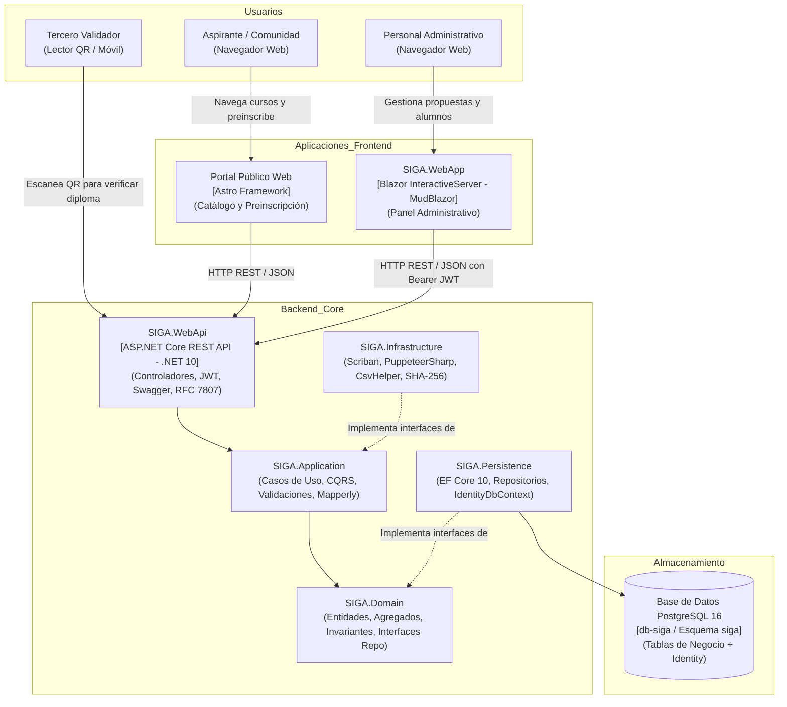
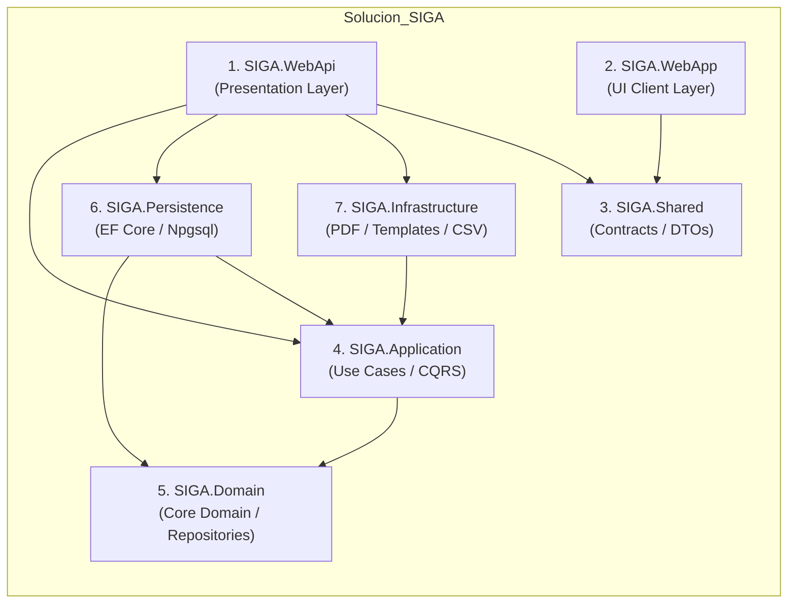
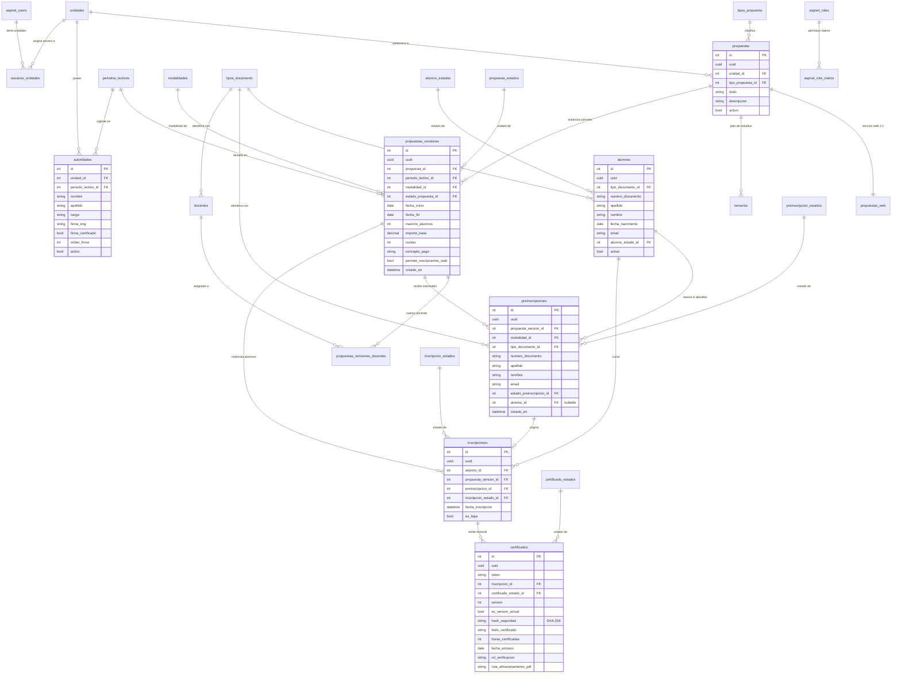
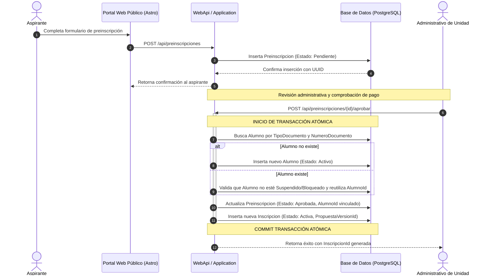
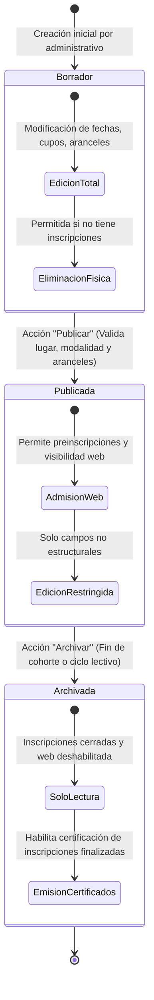
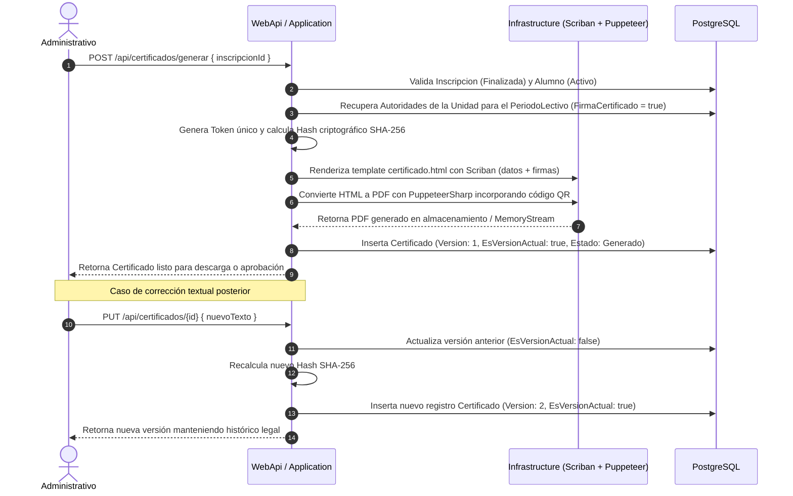
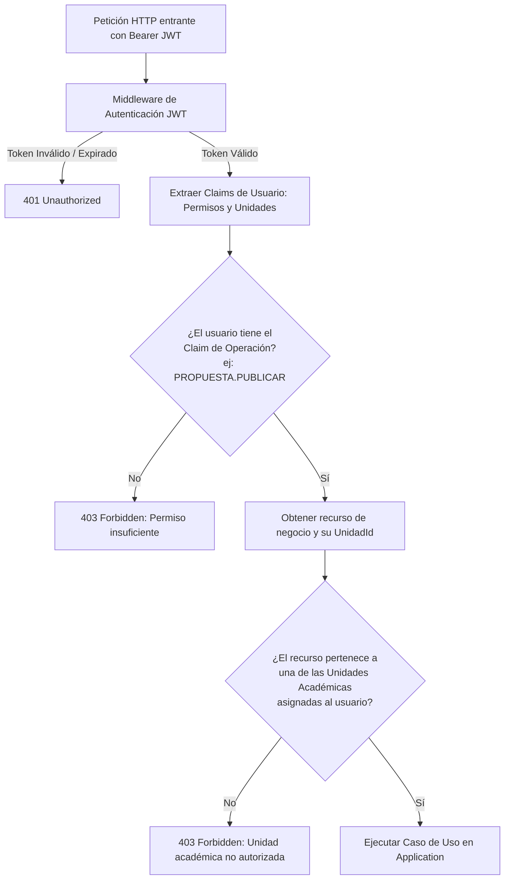

# 03 — Arquitectura del Sistema UCC_SIGA

## 1. Visión General y Estilo Arquitectónico

La solución **UCC_SIGA** adopta los principios de **Clean Architecture** (Arquitectura Limpia) combinada con **CQRS** (Command Query Responsibility Segregation) y organización interna por **Vertical Slices** (rebanadas verticales por caso de uso).

### Principios Rectores:
1. **Independencia del Dominio (Inversión de Dependencias):** La capa `SIGA.Domain` es el núcleo soberano del sistema. No referencia a ninguna librería de infraestructura ni persistencia. Declara los contratos de persistencia que necesita a través de interfaces de repositorio (`SIGA.Domain/Interfaces/Repositories/`).
2. **Desacoplamiento de Persistencia:** `SIGA.Application` no conoce `ApplicationDbContext` ni Entity Framework Core; interactúa con el dominio a través de agregados y repositorios, y delega consultas complejas de lectura a `QueryServices`.
3. **Mediador Propio sin MediatR:** Se implementa un despachador desacoplado (`UseCaseDispatcher`) montado nativamente sobre el contenedor de dependencias (`IServiceProvider`) de ASP.NET Core, evitando dependencias externas pesadas.
4. **Mapeo en Tiempo de Compilación:** Se utiliza exclusivamente **Riok.Mapperly** mediante generadores de código fuente (*source generators*), eliminando sobrecargas en runtime y garantizando chequeos de tipos estrictos.

---

## 2. Diagrama de Contenedores y Contexto (C4)

---

## 3. Estructura y Responsabilidad de Capas .NET

| Capa / Proyecto | Dependencias | Responsabilidad Técnica |
|---|---|---|
| **`SIGA.Domain`** | Ninguna (cero referencias a capas externas) | Entidades de negocio (`Propuesta`, `PropuestaVersion`, `Alumno`, `Inscripcion`, `Certificado`), Enums, Excepciones (`DomainException`) y contratos de persistencia (`IRepository<T>`, `IUnitOfWork`). |
| **`SIGA.Application`** | `SIGA.Domain` | Casos de uso estructurados por Vertical Slices (`Features/`), Commands, Queries, Dispatcher nativo, validadores FluentValidation, mapeos Riok.Mapperly e interfaces de Query Services. |
| **`SIGA.Persistence`** | `SIGA.Application`, `SIGA.Domain` | `ApplicationDbContext : IdentityDbContext<ApplicationUser, ApplicationRole, int>`, mapeos de entidades EF Core (`IEntityTypeConfiguration<T>`), implementación de repositorios y migraciones PostgreSQL. |
| **`SIGA.Infrastructure`** | `SIGA.Application` | Implementación de servicios técnicos auxiliares: `CertificadoPdfService` (Scriban + PuppeteerSharp), `ReporteService` (CsvHelper) y generador criptográfico SHA-256. |
| **`SIGA.WebApi`** | `SIGA.Application`, `SIGA.Persistence`, `SIGA.Infrastructure`, `SIGA.Shared` | Host REST API, Composition Root (inyección de dependencias), autenticación JWT con ASP.NET Core Identity, middleware de manejo global de excepciones (ProblemDetails) y OpenAPI/Swagger. |
| **`SIGA.WebApp`** | `SIGA.Shared` | Frontend administrativo en Blazor Server con MudBlazor 8.*. Consume exclusivamente los endpoints de `SIGA.WebApi` mediante `HttpClient`. |
| **`SIGA.Shared`** | Ninguna | Contratos DTO compartidos y modelos de respuesta comunes. |

---

## 4. Diagrama Entidad-Relación Consolidado (ERD)

---

## 5. Flujos de Datos Críticos

### 5.1 Flujo de Admisión y Matriculación Atómica

### 5.2 Ciclo de Vida y Transición de Estados de PropuestaVersion

### 5.3 Flujo de Emisión y Versionado de Certificados

---

## 6. Esquema de Seguridad y Doble Dimensión

