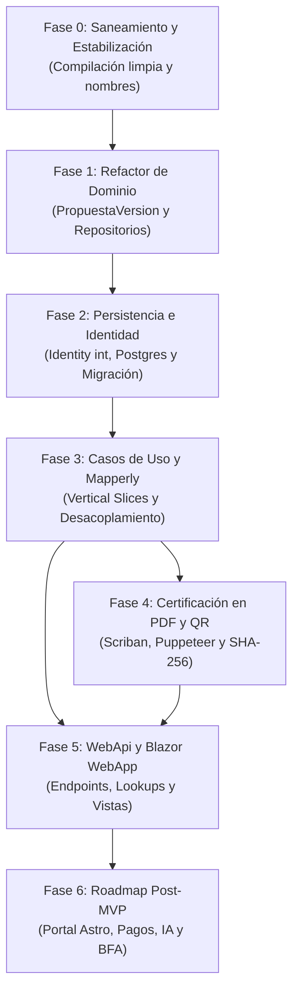

# 06 — Hoja de Ruta Priorizada (Roadmap de Implementación)

Este documento detalla las fases de desarrollo ordenadas por prioridad técnica y dependencias lógicas para transformar el repositorio actual en el sistema operativo **UCC_SIGA**.

---

## Matriz de Fases y Dependencias

---

## Detalle de Fases de Trabajo

### FASE 0: Saneamiento Inmediato y Desbloqueo de Compilación
- **Objetivo:** Lograr que la solución completa compile con cero errores `CS0272` y `CS0246`.
- **Tareas Concretas:**
  1. Cambiar los accesores de `EntityBase` (`Id`, `Codigo`, `Nombre`, `Descripcion`, `Activo`) a `public set` para permitir el sembrado en `Configurations`.
  2. Eliminar referencias y comandos de escritura de `Unidades` en `Application/DependencyInjection.cs` y `UnidadController.cs`.
  3. Purgar stubs sin propósito (`SIGA.Shared/Class1.cs`) y archivos Razor vacíos que generen ruido.
  4. Alinear nombres de archivos con sus clases internas (`LandingPage.cs` $\rightarrow$ `PropuestaWeb.cs`, `PropuestaDTO.cs` $\rightarrow$ `CrearPropuestaResponse.cs`, etc.).
  5. Corregir namespace de configuraciones en `SIGA.Persistence/Configurations/` a `SIGA.Persistence.Configurations`.
- **Dependencias:** Ninguna (punto de partida obligatorio).
- **Criterio de Aceptación:** `dotnet build` finaliza con éxito (0 errores).

---

### FASE 1: Reestructuración del Modelo de Dominio y Contratos
- **Objetivo:** Modelar las nuevas entidades y estados de negocio acordados.
- **Tareas Concretas:**
  1. Crear la entidad `PropuestaVersion` (cohorte temporal con fechas, cupos no persistidos, aranceles y estado).
  2. Ajustar `Propuesta` como catálogo madre permanente (vínculo 1:1 con `PropuestaWeb` y 1:N con `Temario`).
  3. Actualizar `Preinscripcion` e `Inscripcion` para asociarse a `PropuestaVersionId`.
  4. Actualizar `Docente` con `TipoDocumentoId` y `NumeroDocumento` (eliminando la discrepancia con `Dni`).
  5. Crear la tabla intermedia `PropuestaVersionDocente`.
  6. Actualizar `EstadoCertificadoEnum` incorporando los 6 estados oficiales de negocio.
  7. Incorporar en `Autoridad` las propiedades `FirmaCertificado` (bool) y `OrdenFirma` (int).
  8. Definir las interfaces de repositorio (`IPropuestaRepository`, `IInscripcionRepository`, `ICertificadoRepository`, etc.) y `IUnitOfWork` en `SIGA.Domain/Interfaces/Repositories/`.
- **Dependencias:** Fase 0.
- **Criterio de Aceptación:** El dominio refleja fielmente las entidades y reglas sin dependencias a librerías externas.

---

### FASE 2: Módulo de Seguridad y Persistencia en PostgreSQL
- **Objetivo:** Integrar ASP.NET Core Identity y consolidar el esquema de base de datos.
- **Tareas Concretas:**
  1. Configurar `ApplicationUser : IdentityUser<int>` y `ApplicationRole : IdentityRole<int>`.
  2. Crear la entidad y configuración EF Core para `UsuarioUnidadAcademica`.
  3. Modificar `ApplicationDbContext` para heredar de `IdentityDbContext<ApplicationUser, ApplicationRole, int>`.
  4. Implementar los repositorios concretos y `UnitOfWork` en `SIGA.Persistence`.
  5. Eliminar migraciones desactualizadas o redundantes y generar una migración inicial limpia (`InitialDatabaseClean`).
  6. Probar la aplicación de la migración sobre el contenedor PostgreSQL 16.
- **Dependencias:** Fase 1.
- **Criterio de Aceptación:** Base de datos recreada en PostgreSQL con esquema `siga` completo y tablas de Identity operativas.

---

### FASE 3: Capa de Aplicación, Mapeo y Casos de Uso
- **Objetivo:** Desacoplar Application de Persistence e implementar los casos de uso principales.
- **Tareas Concretas:**
  1. Eliminar la referencia de proyecto de `SIGA.Application.csproj` hacia `SIGA.Persistence.csproj`.
  2. Desinstalar paquete `Mapster` e instalar `Riok.Mapperly`.
  3. Implementar casos de uso por Vertical Slice (`Features/`):
     - `Propuestas`: Crear Borrador, Crear Versión, Publicar Versión, Archivar Versión.
     - `Preinscripciones`: Crear Preinscripción Pública, Listar Pendientes.
     - `Inscripciones`: Aprobar Preinscripción (transacción atómica con Alumno), Dar de Baja, Finalizar.
     - `Lookups`: Consultas optimizadas de Unidades, Modalidades y Tipos de Propuesta.
  4. Agregar validadores FluentValidation para cada Command de entrada.
- **Dependencias:** Fase 2.
- **Criterio de Aceptación:** Casos de uso desacoplados que interactúan exclusivamente con repositorios de dominio y DTOs generados con Mapperly.

---

### FASE 4: Motor de Certificación en PDF y Verificación Criptográfica
- **Objetivo:** Operativizar la emisión y validación de certificados.
- **Tareas Concretas:**
  1. Instalar `Scriban` y `PuppeteerSharp` en `SIGA.Infrastructure`.
  2. Implementar servicio de hashing criptográfico SHA-256 para `Certificado`.
  3. Implementar `CertificadoPdfService` que ensamble datos del alumno, propuesta y autoridades en `certificado.html`, genere el QR e imprima el archivo PDF.
  4. Implementar el caso de uso de versionado histórico (rectificación de certificados sin eliminación física).
- **Dependencias:** Fase 3.
- **Criterio de Aceptación:** Emisión exitosa de un archivo PDF con estilos CSS aplicados, firmas correctas y código QR escaneable.

---

### FASE 5: API REST y Frontend Administrativo Blazor
- **Objetivo:** Poner a punto la interfaz de usuario interna y la API pública.
- **Tareas Concretas:**
  1. Limpiar controladores en `SIGA.WebApi`: mover `app.MapControllers()` fuera del `if` de Development y conectar middleware de ProblemDetails.
  2. Exponer endpoint de solo lectura `GET /api/lookups` (o `/api/unidades`).
  3. Parametrizar la URL base del backend en `appsettings.json` de `SIGA.WebApp`.
  4. Implementar las vistas administrativas de Propuestas en Blazor (`InicioPropuesta.razor`, `ListaPropuesta.razor`, `DetallePropuesta.razor`).
  5. Limpiar enlaces obsoletos (`counter`, `weather`) en `NavMenu.razor` y agregar accesos a Propuestas, Alumnos y Certificados.
- **Dependencias:** Fases 3 y 4.
- **Criterio de Aceptación:** Usuario administrativo puede loguearse, dar de alta una versión de curso, aprobar aspirantes y emitir certificados desde la interfaz web.

---

### FASE 6: Roadmap Post-MVP (Iniciativas Futuras) `[PENDIENTE]`
- **Iniciativas Planificadas:**
  1. **Portal Público en Astro (`US-FUT-01`):** Proyecto web independiente para marketing y preinscripción rápida de la comunidad.
  2. **Pasarela de Pagos Automatizada (`US-FUT-02`):** Integración con Mercado Pago / Plus Pagos mediante webhooks para pase automático a `Inscripto`.
  3. **Generación de Contenido con IA (`US-FUT-03`):** Asistente para redacción de programas de estudio y competencias laborales.
  4. **Anclaje en Blockchain Federal Argentina (`US-FUT-04`):** Sellado de tiempo y notarización de hashes de certificados en la red BFA.
- **Dependencias:** Sistema MVP en producción.
